

  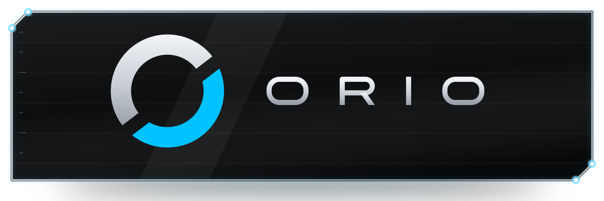

<h1 align="center">Every layer, your way.</h1>

<h3 align="center">60+ tools you won't find anywhere else, in a slicer that's a pleasure to use.</h3>

  Orio is a free, open-source 3D-printing slicer built on Bambu Studio. 
  Same printers, same profiles, same projects. Everyday work just gets a lot smoother, 
  and when you want to go further, you can tune your print part by part, zone by zone, millimeter by millimeter.

  
  &nbsp;
  

  
  
  
  

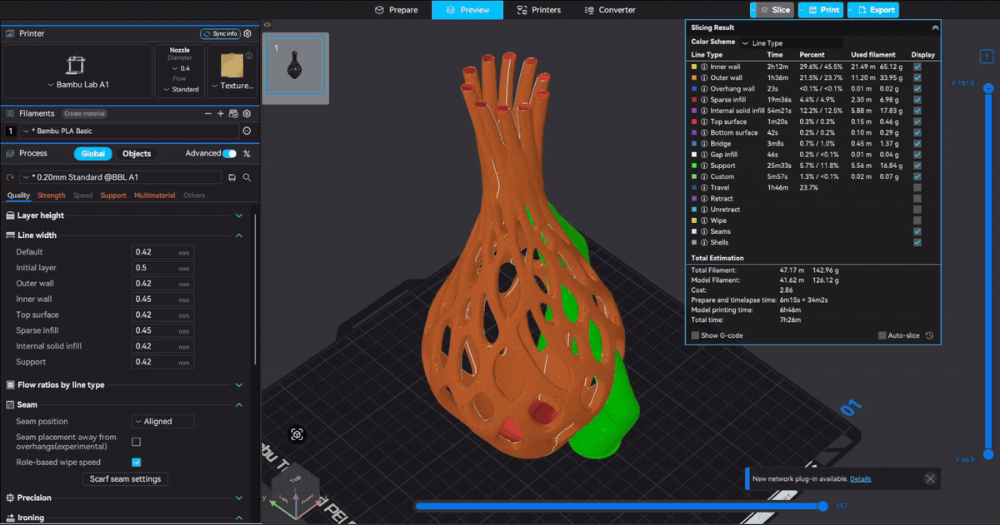

---

## Why Orio?

 **Far more comfortable day to day.** Tool windows float, move, and go to a second screen. The toolbar sits on whichever edge you like. Slicing can run on its own, printing runs in the background, and the preview tells you when it's out of date instead of making your part "disappear".
 

 **Settings nobody else gives you.** Speed, infill, walls, layer height and supports can change along the height of a part or zone by zone. Settings go per plate, per object, per modifier. Every tricky option has an illustrated window that shows what it does.
 

 **Supports only where they help.** Paint classic and tree supports on the same part, and give each zone its own angle, distances and interface.
 

 **Stronger parts, same printer.** Brick layers interlock the walls. Walls run straight through modifiers instead of being cut in two.
 

 **See inside before you print.** Cut the slice along X, Y or Z and look at the real cross-section of every bead. A layer fusion view shows where a part might split.
 

 **The best of three slicers.** OrcaSlicer's multi-material tab, flow ratios and infill patterns, PrusaSlicer's arrange engine, and the whole Bambu Studio and OrcaSlicer printer catalog, all in one app.
 

 **Light and quiet.** No telemetry, no store, no MakerWorld upload. Logs are plain readable text. Nothing leaves your computer.
 

## Highlights

### A workspace you arrange yourself
Floating tool windows you can detach to a second screen, a side panel and a toolbar you drop on any edge, collapsible settings sections, a light / dark switch in the title bar. Tricky settings, like the scarf seam, open in an illustrated window that shows what each value does.

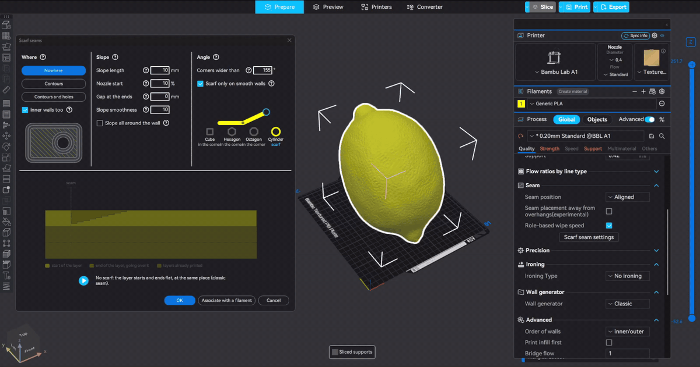

### It keeps up with you
A card tells you plainly when the preview needs a re-slice, and Auto-slice can do it for you. Printing runs in the background. Hold the "previous slice" button to bring back the last result: every value that changed is highlighted.

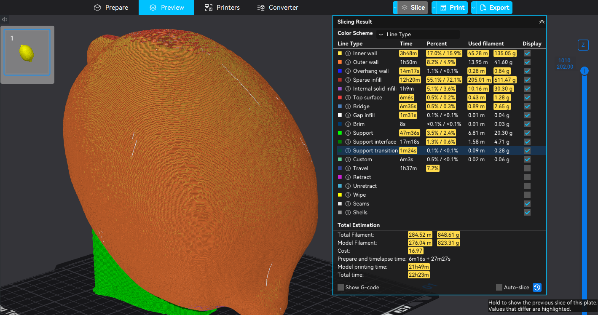

### Settings per plate, per object, per zone
Each plate can have its own printer and settings sheet, linked to others or not. Speeds, accelerations and first-layer settings can be changed for one object only. Supports, walls and infill can change inside a single part, from a box you drop on it or a height range you pick.

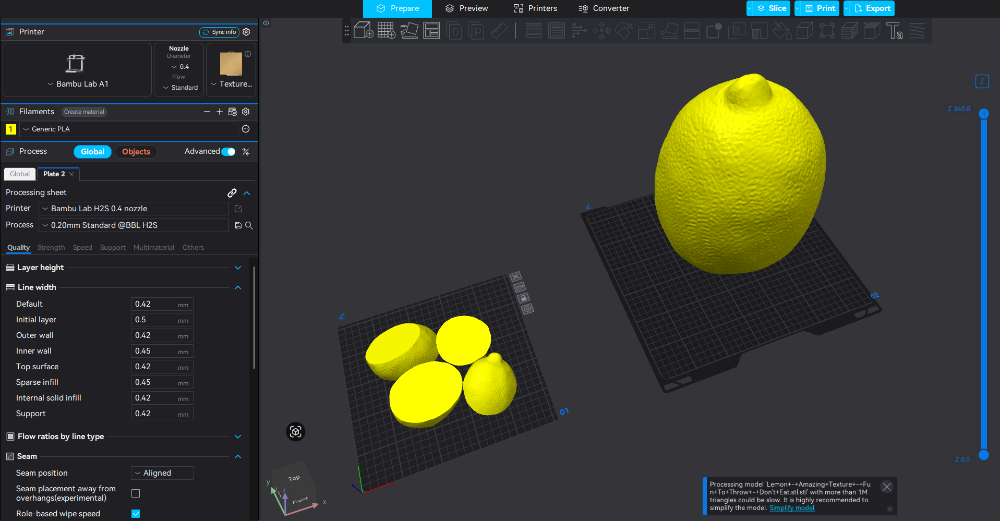

### Speed, infill and walls along the height
A slow, careful bottom and a fast top. Two walls and 10 % infill at the bottom, five walls and 40 % at the top, without splitting the object. Paint the values on a ruler along Z, X or Y, and see them on the part before you slice. Each line type has its own speed curve, and Orio shows the speed your filament can actually reach.

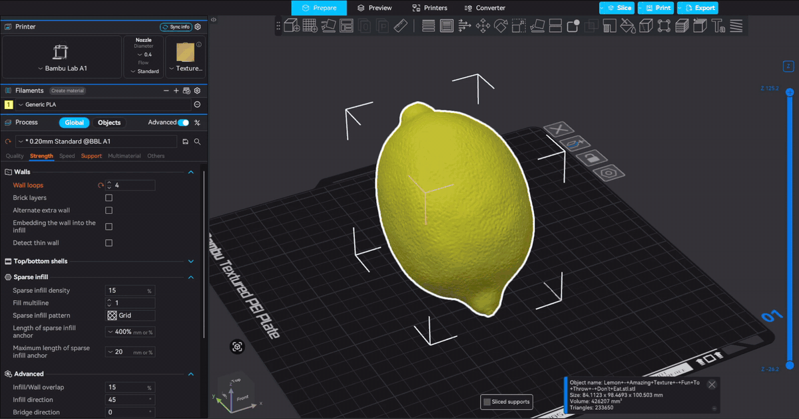

  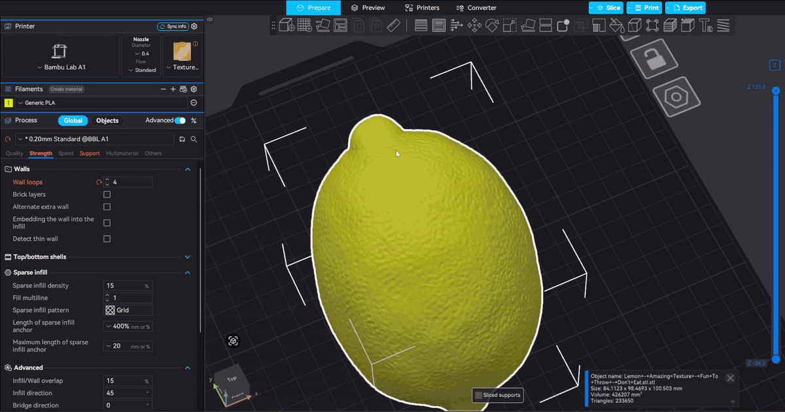
  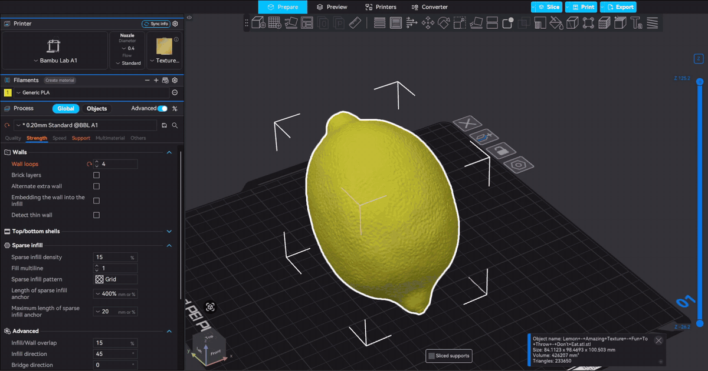

### Supports, zone by zone
Classic and tree supports on the same part, in the same slice: the brush has a color for each style. Drop a box on one area and change the threshold angle, distances, interface or branch diameter there only.

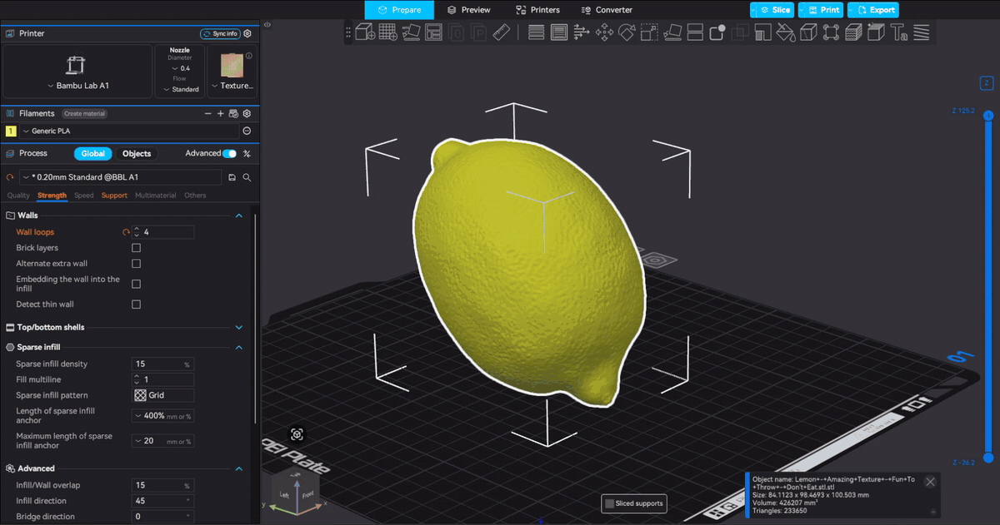

### Brick layers
Every other inner wall is printed half a layer higher, so the walls lock together like bricks and the part holds better between layers. It's built into the slicer, so the preview is exact and there's no post-processing script. You can set it per object, part, modifier or height range.

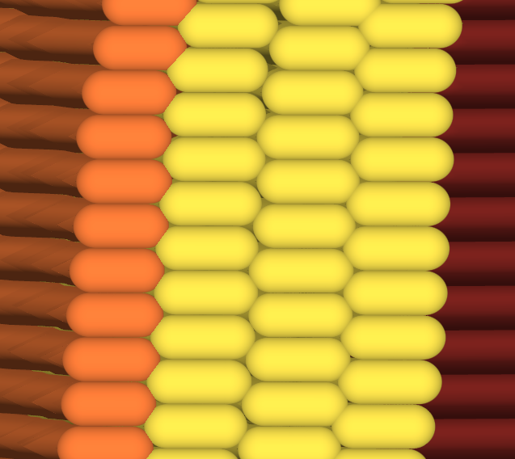

### X / Y / Z cuts and the real bead cross-section
Besides the layer slider, the preview can cut the slice vertically. On the cut, each bead shows its true width and height, so overlaps and gaps between walls become visible. Cuts can be combined and are remembered per plate.

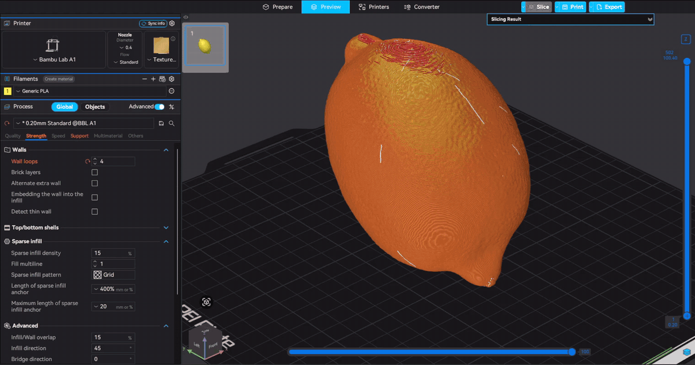

### Layer fusion view
Each line is colored by how much of its width rests on the layer below (red on air, blue fully supported), with the bonded area of the clicked part, layer by layer.

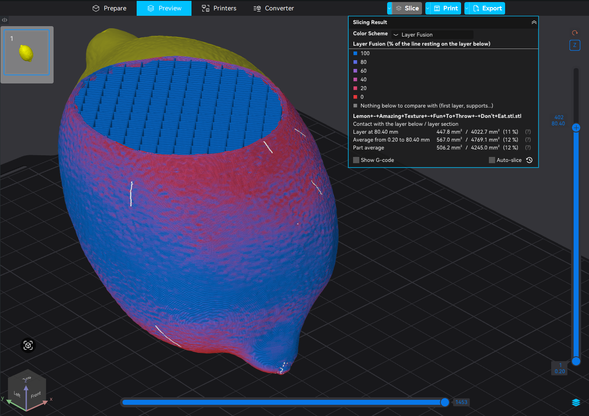

### Precise cutting and modifiers
Cut on several planes at once, with numbered pieces and connectors that snap to the notable points of the cut face (ISO threads from M3 to M600). Place modifiers, holes and support blockers to the millimeter, snapped to the part.

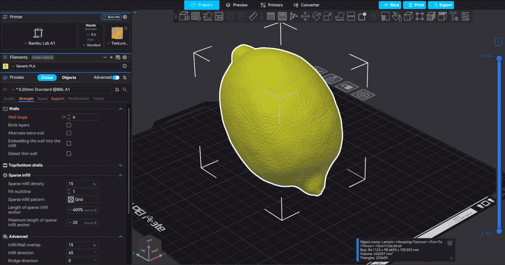

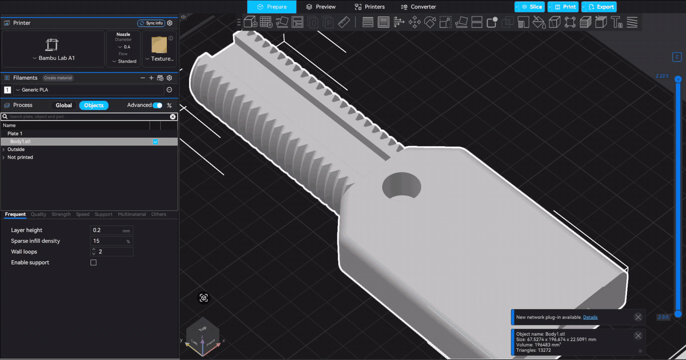

**[See all 60+ features](docs/FEATURES.md)**

## Orio and Bambu Studio

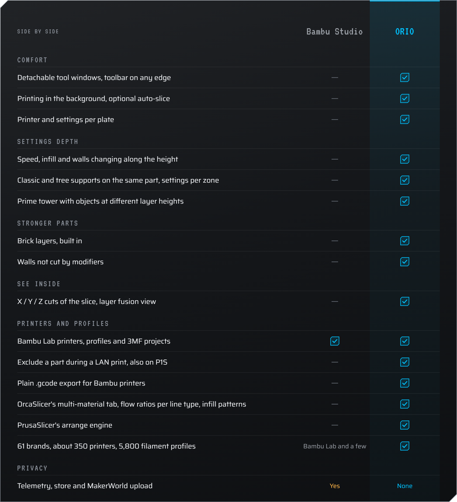

Same comparison as text

| | Bambu Studio | **Orio** |
|---|:---:|:---:|
| Bambu Lab printers, profiles and 3MF projects | Yes | Yes |
| Detachable tool windows, toolbar on any edge | No | Yes |
| Printing in the background while you keep working, optional auto-slice | No | Yes |
| Printer and settings per plate | No | Yes |
| Brick layers, built in | No | Yes |
| Speed, infill and walls changing along the height | No | Yes |
| Walls not cut by modifiers | No | Yes |
| Classic and tree supports on the same part, settings per zone | No | Yes |
| X / Y / Z cuts of the slice, layer fusion view | No | Yes |
| Prime tower with objects at different layer heights | No | Yes |
| Exclude a part during a LAN print, also on P1S | No | Yes |
| Plain `.gcode` export for Bambu printers | No | Yes |
| Multi-material tab, flow ratios per line type, extra infill patterns (from OrcaSlicer) | No | Yes |
| PrusaSlicer's arrange engine | No | Yes |
| 61 brands, about 350 printers, 5,800 filament profiles | Bambu Lab and a few others | Yes |
| Telemetry, store and MakerWorld upload | Yes | **None** |

## Download and install

1. Download `Orio-<version>-win64.zip` from the **[latest release](https://github.com/OrioSlicer/Orio/releases/latest)**.
2. Optional: check the file against the SHA-256 checksum published with the release (`Get-FileHash Orio-*.zip` in PowerShell).
3. Unzip it anywhere and run `orio.exe`. No installer, nothing written outside `%APPDATA%\Orio`. Orio sits next to Bambu Studio without getting in its way.

**Windows says "Windows protected your PC"?** Orio isn't code-signed (a certificate costs several hundred dollars a year). Click **More info**, then **Run anyway**. The source of every release is right here, and the release notes give the checksum of the zip.

**Requirements:** Windows 10 or 11, 64-bit, and a graphics card with OpenGL 3.2 or later. macOS and Linux builds aren't available yet.

**Languages:** English and French are built in. Czech, Dutch, German, Hungarian, Italian, Japanese, Korean, Polish, Portuguese (Brazil), Russian, Spanish, Swedish, Turkish, Ukrainian and Chinese (simplified and traditional) download on demand from *Preferences > Language*.

## Printing with a Bambu Lab printer

 Orio is meant to be used with your printer in **LAN mode** (local network). The step-by-step guide is here: **[docs/LAN-MODE.md](docs/LAN-MODE.md)**.
 

## Ideas, questions, bugs

 **Ideas and suggestions:** [Discussions > Ideas](https://github.com/OrioSlicer/Orio/discussions/categories/ideas). Upvote the ones you'd like to see. 
 **Questions:** [Discussions > Q&A](https://github.com/OrioSlicer/Orio/discussions/categories/q-a) 
 **Show your prints:** [Discussions > Show and tell](https://github.com/OrioSlicer/Orio/discussions/categories/show-and-tell) 
 **Bugs:** [open an issue](https://github.com/OrioSlicer/Orio/issues/new/choose) (also from Orio: *Help > Report issue*). Please attach the 3MF project.

What's coming next: **[ROADMAP](docs/ROADMAP.md)**. Common questions: **[FAQ](docs/FAQ.md)**.

## Support Orio

Orio is free and will stay free. The best ways to help for now:

 **Star** the repository, it helps other makers find it. 
 **Share** your prints and Orio with your printing friends. 
 **Translate** Orio into your language, see [CONTRIBUTING](CONTRIBUTING.md). 
 **Sponsor:** a GitHub Sponsors page is on the way.

## Credits and license

Orio stands on the shoulders of giants. It's a fork of **[Bambu Studio](https://github.com/bambulab/BambuStudio)** by Bambu Lab, itself based on **[PrusaSlicer](https://github.com/prusa3d/PrusaSlicer)** by Prusa Research, which comes from **[Slic3r](https://github.com/slic3r/Slic3r)** by Alessandro Ranellucci and the RepRap community. Several features come from **[OrcaSlicer](https://github.com/SoftFever/OrcaSlicer)** by SoftFever and its contributors, and wave overhangs from **[Unlayered Slicer](https://github.com/Unlayered3D/Unlayered-Slicer)**. Details in **[CREDITS](CREDITS.md)**.

Orio is licensed under the **GNU Affero General Public License v3.0**, see [LICENSE](LICENSE).

> Orio is an independent project. It isn't affiliated with, endorsed or supported by Bambu Lab, Prusa Research or the OrcaSlicer project. Bambu Lab and all printer and filament names are trademarks of their respective owners, used only to describe compatibility. Orio is provided as is, without warranty: always keep an eye on your first prints with a new feature.
